<h1 align="center">Hi there, I'm Adith 👋</h1>

  <strong>Full-Stack &amp; Mobile Developer · Computer Engineering Background</strong> 
  Building connected applications, thoughtful interfaces, and tools that simplify everyday work.

  

  
  
  
  
  

---

## About Me

I'm a developer with a background in **Computer Engineering**, working across **mobile applications, web platforms, and backend services**. My current projects focus on internal business applications: correspondence and archives, helpdesk services, talent management, and payment workflow prototypes.

I work with **Flutter and Dart** on mobile, **Nuxt and Vue** on the web, and **NestJS and TypeScript** on the backend. I enjoy connecting these layers through clear APIs, consistent design systems, and authentication flows that work across applications.

My interests also extend to **applied AI, computer vision, and embedded systems**—from dental caries classification and segmentation research to OCR tools and AI-assisted application features.

## What I Work On

- **Mobile development:** Modular Flutter applications with GetX, REST API integration, push notifications, document viewers, localization, and light/dark themes.
- **Full-stack web development:** Nuxt/Vue interfaces, NestJS services, data persistence, dashboards, and business workflows.
- **Authentication & access control:** SSO integration, OAuth/OIDC with PKCE, session management, token refresh, and role-based permissions.
- **Design systems:** Shared UI components, design tokens, reusable layouts, and documentation for consistent application interfaces.
- **Applied AI:** Context-aware assistants, language model API integration, OCR, and experiments connecting mobile apps with desktop tools.
- **Engineering practices:** Automated tests, API documentation, QA/UAT materials, and containerized application setup.

## Selected Projects

| Project | Focus | Technologies |
| --- | --- | --- |
| **ArsipKu** | Web and mobile correspondence and archive management, including document workflows, approvals, digital-signature integration, search, and notifications. | Flutter, Nuxt, NestJS, MySQL, MongoDB, Redis, Socket.IO |
| **AirNav Helpdesk** | Mobile support-ticket workflows for reporters, technicians, and administrators, with chat, dashboards, notifications, and AI-assisted FAQ search. | Flutter, GetX, Dio, Firebase, Socket.IO |
| **New ITMS** | Web, API, and mobile development for competency assessment, performance, employee development, and talent management. | Nuxt, NestJS, Flutter, Prisma, PostgreSQL, Redis |
| **AirNav Design System** | Shared UI foundations, reusable components, application blocks, and documentation, with a Nuxt layer and Bootstrap styling. | Vue, Nuxt UI, Tailwind CSS, Bootstrap, ECharts |
| **AirNav Super App** | A Flutter host bringing ArsipKu, Helpdesk, and New ITMS together through a shared portal and module navigation. | Flutter, Dart, GetX |
| **DigiPay - in development** | Payment workflow prototyping with forms, approval flows, document previews, and transaction timelines; backend work currently focuses on SSO and sessions. | Nuxt, Vue, TypeScript, NestJS, Redis |

## Tech Stack

### Mobile

  

GetX · Dio · Firebase Cloud Messaging · Socket.IO · Secure Storage · Localization

### Web & Backend

  

Nuxt UI · REST APIs · OpenAPI/Swagger · OAuth/OIDC · PKCE · Role-Based Access Control

### Data & Development Tools

  

TypeORM · Jest · Flutter Testing · API Documentation · QA & UAT

### Research & Exploration

  

FastAPI · OCR · Language Model APIs · Image Classification & Segmentation · IoT & Embedded Systems

## Beyond the Code

- **Leadership:** Head of Public Relations (Kadiv Humas), Himatekkom.
- **Research:** Computer vision work involving dental caries classification and segmentation models.
- **Collaboration:** Technical documentation, QA/UAT preparation, and communication across application modules and teams.

I care about making complex workflows easier to understand—both for the people using the software and the people maintaining it.

## 🕹️ Adith's Arcade

  

  Collect code. Dodge bugs. Ship the build. Repeat. A custom autoplay arcade animation made for this profile.

## GitHub Stats

  
More GitHub stats

  

    
    
  

  

    
  

  <a href="mailto:adityayufnanda25@gmail.com"><strong>Let's connect and build something useful.</strong></a>

  

  

